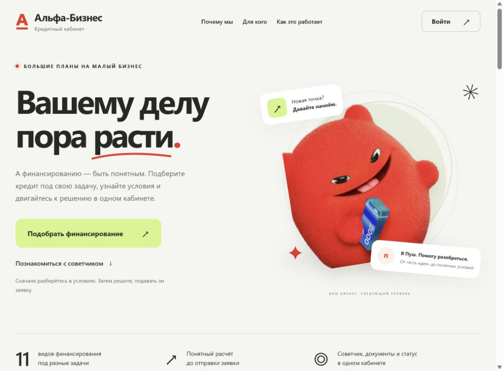
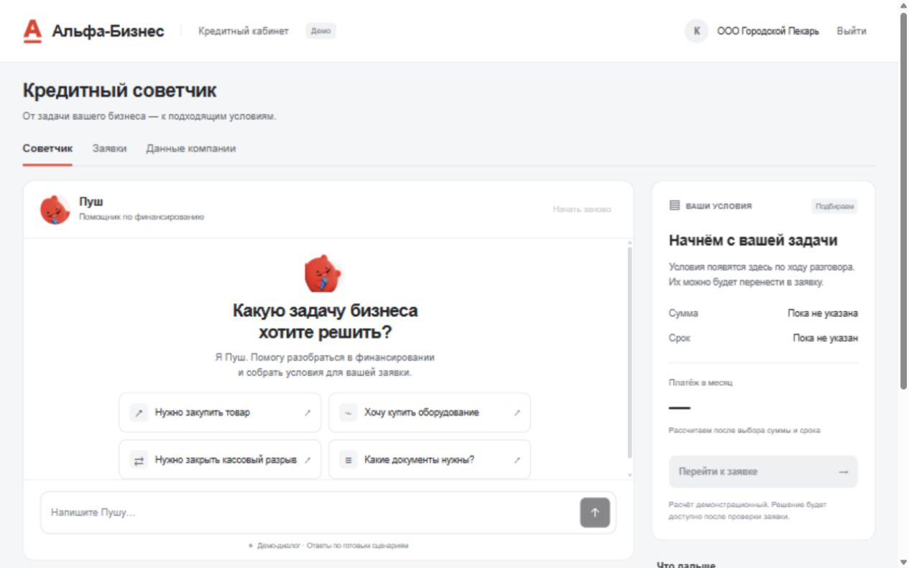
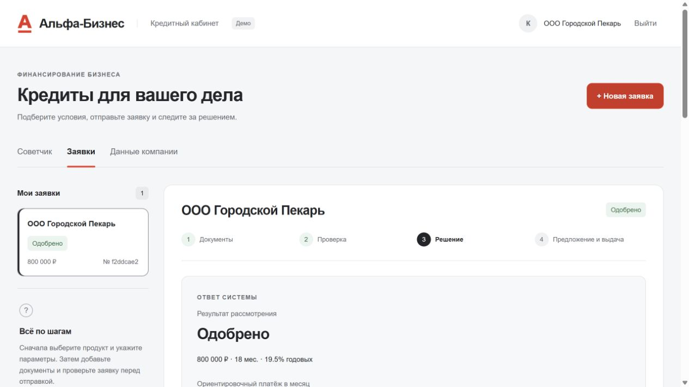
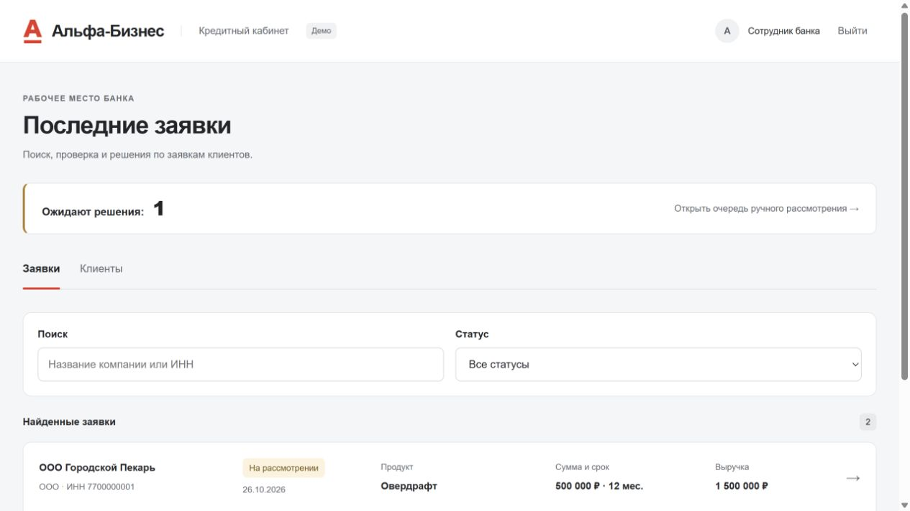
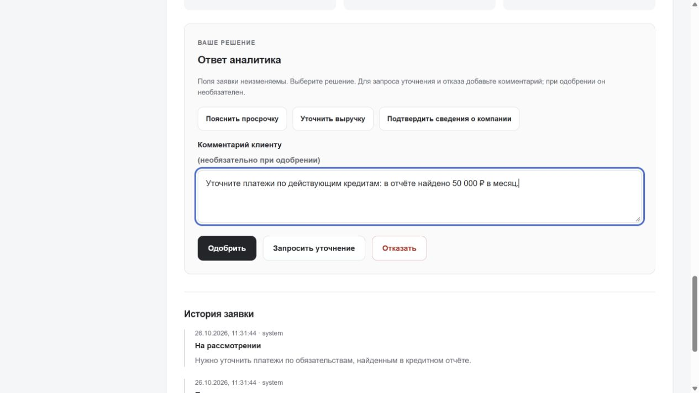
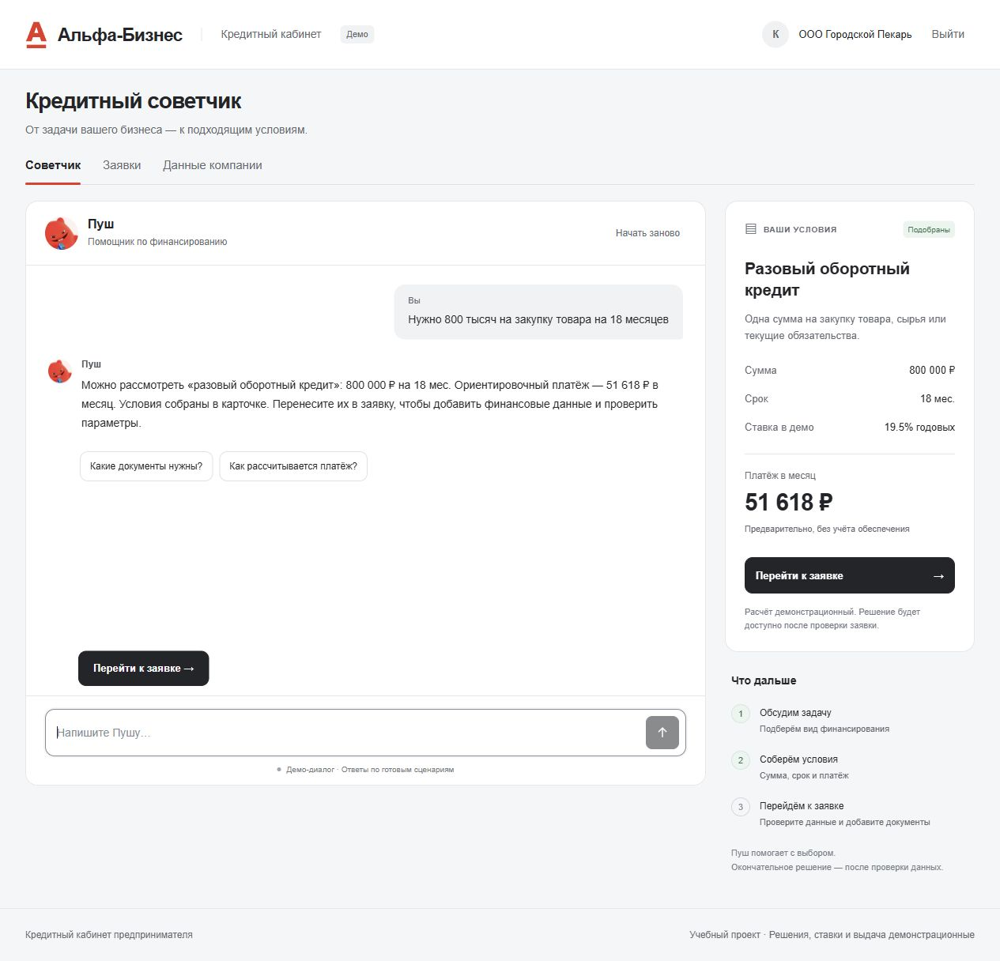

# Кредитный кабинет предпринимателя

Проект для кейса «Умный кредитный кабинет предпринимателя». Предприниматель описывает, на что нужны деньги, выбирает финансирование, загружает документы и получает ответ в одном кабинете. Если банку нужны пояснения, клиент дополняет ту же заявку, а не начинает всё заново.

Сотрудник банка видит очередь заявок, данные компаний и причины предварительного решения. Он может запросить уточнение, одобрить заявку на ручном рассмотрении или отказать с объяснением.

[Запуск](#как-запустить) · [Доступы](#тестовые-учётные-записи) · [Проверка для жюри](#что-проверить) · [Скриншоты](#как-это-выглядит) · [Развитие проекта](#дальнейшее-развитие-проекта)

## Как запустить

### Основной запуск для жюри — Docker

Нужны Git, Docker Engine или Docker Desktop с Docker Compose v2 и браузер.
Ориентир для обычного ПК: 2 ядра, 2 ГБ свободной оперативной памяти и 2 ГБ диска.
Отдельные Python, Node.js, СУБД, ключи API и платные сервисы для запуска не нужны.

Проверьте, что Docker запущен и команда Compose доступна:

```bash
docker version
docker compose version
git clone https://github.com/EvGeniy0505/alpha_hackathon.git
cd alpha_hackathon
docker compose up --build --detach --wait
```

Откройте [localhost:8000](http://localhost:8000), затем «Войти».
Для проверки готовности откройте [localhost:8000/health](http://localhost:8000/health):
ожидается JSON с `status: "ok"`.
Первый запуск требует интернета для скачивания образа Python; работа приложения — автономная.

```bash
docker compose ps
docker compose logs --tail=100 app
docker compose down
```

Данные сохраняются в именованном томе `credit-data`; остановка через
`docker compose down` не удаляет заявки. Не используйте `down -v`,
если нужно сохранить демонстрационные данные.
При занятом порте 8000 задайте `APP_PORT=18080` в `.env` на основе `.env.example`
и откройте localhost:18080. Публикуемый порт меняется без правки кода.
В контейнере процесс работает без root, код доступен только для чтения,
SQLite и сессии хранятся в томе, готовность проверяет HEALTHCHECK.
Это одноконтейнерный MVP: для нескольких реплик потребуется внешняя серверная БД.

### Дополнительный запуск без контейнера

В проекте закреплён Python **3.12.10** — эта версия указана в `.python-version` и Dockerfile. Также проект проверен на Python 3.14.3. Нужны Git и браузер; устанавливать Python-пакеты, Node.js или собирать фронтенд для запуска не требуется.

```bash
git clone https://github.com/EvGeniy0505/alpha_hackathon.git
cd alpha_hackathon
python server.py
```

Если проект уже скачан, откройте терминал в его папке и выполните только `python server.py`. На Windows вместо этой команды можно использовать `py -3.12 server.py`, если установлен Python 3.12.

Откройте [localhost:8000](http://localhost:8000). На главной нажмите «Войти». Прямой адрес входа — [localhost:8000/login](http://localhost:8000/login).

При первом запуске создаются тестовые пользователи и база `runtime/credit.db`. Сохранённые заявки остаются после перезапуска. Приложение работает локально, без внешних запросов.

## Тестовые учётные записи

| Роль | Логин | Пароль |
|---|---|---|
| Предприниматель — ООО «Городской Пекарь» | `client` | `client-pass` |
| Другой предприниматель | `client2` | `client2-pass` |
| Остальные клиенты | `client3` … `client10` | `client3-pass` … `client10-pass` |
| Сотрудник банка | `analyst` | `analyst-pass` |

Десять компаний и реквизиты входа описаны в [data/clients.json](data/clients.json). Новая база содержит профили клиентов, но заявки нужно создать самостоятельно.

Для проверки двух ролей можно выходить из аккаунта и входить под другим логином. Если нужны оба кабинета одновременно, откройте второй в другом браузере или приватном окне: вкладки одного обычного окна используют общую сессию.

## Что уже сделано

- **Подбор финансирования.** Каталог из 11 продуктов, пошаговый помощник и разговорный советчик с Пушем. Цель, сумма и срок переносятся из диалога в форму по нажатию клиента.
- **Заявка без диалога.** Кнопка «Новая заявка» доступна сразу после входа, в том числе на экране Пуша. Можно сразу выбрать продукт, заполнить форму и сохранить черновик или отправить заявку.
- **Профиль компании.** Реквизиты и постоянные сведения редактируются отдельно и подставляются в заявку.
- **Заявки и документы.** Черновики, загрузка CSV-выписки и сводной отчётности, финансовые показатели за 6 или 12 месяцев, выбор обеспечения и согласия клиента.
- **Понятный расчёт.** Платёж, запас денег после расходов и кредитных платежей, сезонность поступлений, зависимость от крупнейшего покупателя и сверка выручки с документами. DSCR здесь показывает, во сколько раз свободные средства покрывают новый платёж.
- **Три результата.** Автоматическое одобрение, ручное рассмотрение и отказ. При проблемах с денежным потоком система ищет другую сумму или срок и повторно проверяет предложенный вариант.
- **Рабочее место банка.** Очередь ручного рассмотрения, поиск по компании и ИНН, фильтры статусов, реестр клиентов и история их заявок.
- **Уточнение в той же заявке.** Банк задаёт вопрос, клиент меняет поля и документы, добавляет ответ и отправляет заявку повторно. Действия остаются в истории.
- **Завершение процесса.** Клиент принимает одобренные условия; система записывает демонстрационные этапы подписания и выдачи.
- **Хранение и доступ.** SQLite, вход по паролю, проверка роли и владельца на сервере, защита от повторной отправки и повторного принятия предложения.

## Что проверить

Для основного показа достаточно пройти первые два сценария. Все примеры ниже рассчитаны на исходный профиль `client`: ИНН `7700000001`, возраст бизнеса 36 месяцев. Если профиль уже меняли, сначала верните эти значения в разделе «Данные компании» или запустите приложение с отдельной базой.

### 1. От запроса к одобренной заявке

1. Войдите как `client`. В «Советчике» напишите: **«Нужно 800 тысяч на закупку товара на 18 месяцев»**.
2. Справа должны появиться разовый оборотный кредит, сумма **800 000 ₽**, срок **18 месяцев** и предварительный платёж около **51 618 ₽**. Нажмите «Перейти к заявке» и проверьте перенос условий.
3. Оставьте обеспечение «Без залога». В финансовых показателях за 6 месяцев укажите: выручка **1 500 000 ₽**, операционные расходы **1 000 000 ₽**, платежи по другим кредитам **100 000 ₽** в месяц.
4. Загрузите выписку [stable_business_6m.csv](examples/bank-statements/stable_business_6m.csv). В блоке финансового документа выберите «Декларация УСН» и загрузите [usn_declaration_stable_12m.csv](examples/financial-documents/usn_declaration_stable_12m.csv). Показатели из файлов заполнятся автоматически.
5. Отметьте оба согласия. Нажмите «Проверить параметры» — ожидается **«Одобрено»**. На этом шаге заявка ещё не отправлена в банк.
6. Нажмите «Сохранить черновик», обновите страницу, перейдите в «Заявки» и откройте сохранённый черновик. Поля и рассчитанные показатели документов должны остаться.
7. Нажмите «Отправить в банк». После одобрения появится «Принять условия». Нажатие завершает демонстрационный процесс со статусом **«Выдано»**. Юридическая подпись и перевод денег здесь не выполняются.

Диалог советчика очищается при перезагрузке или выходе. Сохранённая заявка остаётся в базе.

### 2. Ручное рассмотрение и уточнение

1. Под `client` создайте новую заявку. Выберите разовый оборотный кредит, **800 000 ₽ на 18 месяцев**, укажите цель, выручку **1 500 000 ₽**, расходы **1 000 000 ₽**, а платежи по другим кредитам — **0 ₽**.
2. Загрузите те же два CSV и отметьте оба согласия. Отправьте заявку. Ожидается **«На рассмотрении»**: в тестовом кредитном отчёте этого клиента есть платежи **50 000 ₽ в месяц**, которые не указаны в анкете.
3. Выйдите и войдите как `analyst`. Найдите заявку, откройте её, напишите просьбу уточнить действующие платежи и нажмите «Запросить уточнение». Статус изменится на **«Нужно уточнение»**.
4. Вернитесь под `client`, откройте эту заявку, исправьте платежи на **50 000 ₽**, добавьте ответ банку и нажмите «Отправить ответ банку». Создавать новую заявку не нужно.
5. Под `analyst` откройте её снова и нажмите «Одобрить». Комментарий при одобрении необязателен; при отказе и запросе уточнения он обязателен.
6. Проверьте, что клиент видит **«Одобрено»**, в истории остались вопрос и ответ, а счётчик ожидающих решения заявок уменьшился.

После ответа клиента заявка возвращается сотруднику. Текст пояснения сам по себе не отменяет ограничения кредитных правил.

### 3. Отказ и предложение изменить условия

В новой заявке `client` выберите разовый оборотный кредит **600 000 ₽ на 12 месяцев**. Укажите цель, выручку **110 000 ₽**, расходы **10 000 ₽**, платежи по другим кредитам **50 000 ₽** и дайте согласие на кредитный отчёт. Нажмите «Проверить параметры»; для этого предварительного расчёта документы можно не загружать.

Ожидается отказ из-за недостатка денег на новый платёж и блок **«Вариант с другими параметрами»**. До нажатия «Подставить и проверить» исходные сумма и срок остаются прежними. После нажатия система пересчитывает предложенные условия. Без документов результат может остаться на ручном рассмотрении — список недостающих документов будет виден в форме.

При большем сроке ежемесячный платёж может уменьшиться, а общая выплата — вырасти. В интерфейсе показаны обе суммы.

### Ещё несколько проверок

| Действие | Ожидаемый результат |
|---|---|
| Войти под `client2` после создания заявки `client` | Заявки первого клиента не видны |
| Открыть «Клиенты» под `analyst` | Видны десять компаний и переход к заявкам каждой |
| Перезапустить сервер и войти снова | Сохранённые заявки и их история остались |
| Пересчитать параметры без сохранения | Новая заявка в списке не появилась |
| Отправить форму без документов или согласий | Есть объяснение, чего не хватает; выдача не выполняется |
| Открыть кабинет на узком экране | Формы и советчик доступны, блоки идут друг под другом |

Другие примеры документов — в [examples/README.md](examples/README.md): есть сезонная выписка, зависимость от одного покупателя и отчётность с низкой прибылью.

## Как это выглядит

Реальные экраны локальной версии с вымышленными данными.

**Главная страница** — описание сервиса и вход в кабинет.



**Советчик** — разговор о задаче бизнеса и карточка условий.



**Результат заявки** — статус и переход к принятию предложения.



**Кабинет сотрудника** — очередь, поиск и фильтр по статусу.



<details>
<summary>Запрос уточнения, пример диалога и мобильный экран</summary>

Сотрудник задаёт вопрос в карточке заявки.



Советчик собирает сумму, срок и продукт из запроса клиента.



</details>

## Как устроен проект

Python обслуживает страницы и API в одном процессе. Интерфейс написан на HTML, CSS и JavaScript. Заявки, профили, сессии и история хранятся в SQLite. Скоринг и кредитные правила вынесены отдельно от HTTP-сервера.

| Файл или папка | Что внутри |
|---|---|
| [server.py](server.py) | Вход, API, профили, доступ к базе и переходы между статусами |
| [scoring.py](scoring.py) | Каталог продуктов, расчёт платежа, проверки, решения и альтернативы |
| [static/](static/) | Главная, кабинеты клиента и банка, советчик |
| [data/clients.json](data/clients.json) | Десять тестовых компаний и аккаунты для первого запуска |
| [data/demo_profiles.json](data/demo_profiles.json) | Наборы параметров для автоматических тестов трёх исходов |
| [examples/](examples/) | CSV для загрузки в интерфейсе |
| [tests/](tests/) | Проверки API, расчётов и советчика |
| [docs/ARCHITECTURE.md](docs/ARCHITECTURE.md) | Архитектурная схема, состояния заявки, модель данных и ограничения |
| [docs/DEPLOYMENT.md](docs/DEPLOYMENT.md) | Публикация через Docker на Render или своём сервере |
| [docs/API.md](docs/API.md) | Маршруты, роли, ошибки и правила работы с API |
| [docs/TECHNICAL_CHECKLIST.md](docs/TECHNICAL_CHECKLIST.md) | Проверка технических требований и оставшиеся проверки поставки |
| [docs/openapi.json](docs/openapi.json) | Контракт API; также доступен по `/openapi.json` на запущенном сервере |
| [docs/requests.http](docs/requests.http) | Примеры HTTP-запросов |
| [THIRD_PARTY_NOTICES](THIRD_PARTY_NOTICES) | Источники оформления и персонажа Пуша |

### Настройки

| Переменная окружения | По умолчанию | Для чего |
|---|---|---|
| `HOST` | `127.0.0.1` | Адрес локального сервера; в контейнере — `0.0.0.0` |
| `PORT` | `8000` | Порт приложения |
| `DB_PATH` | `runtime/credit.db` | Путь к базе; в контейнере — `/app/runtime/credit.db` |
| `ALLOWED_HOSTS` | `localhost,127.0.0.1,::1` | Допустимые имена хоста через запятую; Compose задаёт `localhost,127.0.0.1` |
| `COOKIE_SECURE` | `0` | `1` для HTTPS; добавляет Secure к cookie входа и выхода |
| `APP_BIND` | `127.0.0.1` | Адрес публикации порта в Docker Compose |
| `APP_PORT` | `8000` | Внешний порт Docker Compose; внутренний остаётся 8000 |
| `RENDER_EXTERNAL_HOSTNAME` | Задаёт Render | Автоматически добавляется в разрешённые имена хоста |

Для отдельной демонстрации без изменения уже сохранённых заявок задайте другой путь к базе. Например, в новом окне PowerShell:

```powershell
$env:DB_PATH = 'runtime/jury-demo.db'
python server.py
```

Новый файл получит исходные тестовые профили и пустой список заявок. Чтобы вернуться к основной базе, запустите сервер из нового терминала без этой переменной.

## Автоматические проверки

```bash
python -m unittest discover -s tests -v
node --test tests/*.test.cjs
```

Для запуска приложения Node.js не требуется; он нужен только для JavaScript-тестов. Python-тесты используют стандартную библиотеку. Коллекция docs/requests.http дополнительно исполняется тестом tests/test_delivery.py.

## Версия для сдачи

До дедлайна укажите в форме сдачи полный результат `git rev-parse HEAD` или опубликованный Git-тег. Используйте эту же версию при показе. Репозиторий публичный, поэтому отдельный доступ аккаунту `alfa-hack-2026` не нужен. Облачный адрес полезен для показа, но в задании он дополнительный.

## Публикация по внешней ссылке

Для бесплатного демонстрационного запуска подготовлен [render.yaml](render.yaml).
[Создать Blueprint на Render](https://render.com/deploy?repo=https://github.com/EvGeniy0505/alpha_hackathon).
Конфигурация использует Docker, HTTPS и `/health`; создание сервиса выполняется в вашем аккаунте.
На Free локальная SQLite сбрасывается при перезапусках и остановке по неактивности.
Основная версия с постоянными данными — Docker Compose с именованным томом.
Подробные шаги и ограничения: [docs/DEPLOYMENT.md](docs/DEPLOYMENT.md).

## Дальнейшее развитие проекта

1. **ИИ-помощник с открытыми весами.** Подключить к Пушу языковую модель, чтобы он понимал более свободные формулировки, уточнял потребность бизнеса и объяснял условия продуктов. Параметры заявки должны проверяться по каталогу, а отправка и принятие условий — оставаться действиями клиента.
2. **Расширенная работа с выписками и документами.** Добавить импорт выписок разных банков в XLSX и PDF, распознавание данных и автоматическую категоризацию операций. Сопоставлять несколько периодов, выявлять дубли и расхождения с отчётностью, подробнее показывать сезонность и структуру денежных потоков.
3. **Возможный ML-скоринг.** Исследовать модель оценки кредитного риска на подходящих данных, проверить её качество, калибровку и объяснимость. Сравнивать результаты с текущими правилами; скоринговую оценку использовать как дополнительный фактор в отдельной логике кредитного решения.
4. **Сценарное планирование финансирования.** Добавить прогноз денежных потоков с учётом сезонности, сравнение графиков погашения и сценариев изменения доходов и расходов. Показывать, как разные сумма, срок и продукт влияют на финансовый запас бизнеса.
5. **Интеграции с источниками данных.** Развивать адаптеры реестров компаний, БКИ и банковских данных с явным согласием клиента, обработкой ошибок и сохранением происхождения сведений. Для автономной демонстрации сохранить локальные симуляторы.
6. **Совместная работа и масштабирование.** Расширить роли сотрудников, задачи и уведомления внутри кабинета. Для нескольких экземпляров сервиса перейти к PostgreSQL, добавить версионирование данных, резервное копирование и мониторинг.
