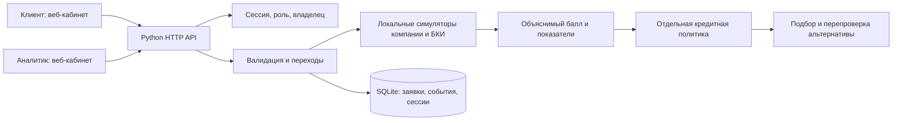
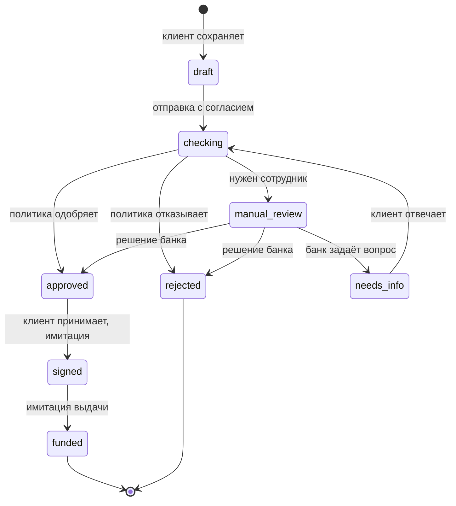

# Архитектура и границы MVP

## Компоненты

Все компоненты в одном процессе/контейнере. Слой правил не зависит от HTTP и БД. Внешние вызовы отсутствуют. Это вертикальный срез процесса, а не банковская платформа.

## Состояния

`checking` и `signed` — короткие синхронные этапы, записываемые в историю. UI получает итог запроса; фоновых очередей и выдуманного ожидания нет.

После уточнения неблокирующий результат снова передаётся человеку. Пояснение клиента само по себе не отменяет просрочку или другой отрицательный факт. Автоматически отклонённую заявку нельзя одобрить через банковский endpoint.

## Данные

| Таблица | Поля | Смысл |
|---|---|---|
| `applications` | `id` PK, `owner`, `status`, `data` JSON, `assessment` JSON, `created_at`, `updated_at` | Последняя версия заявки и расчёта |
| `events` | `id` PK, `application_id` FK, `at`, `status`, `actor`, `note` | Хронология действий |
| `sessions` | `token_hash` PK, `username`, `expires` | SHA-256 токена случайной сессии, срок 8 часов |

Учебные пользователи фиксированы в `USERS`, отдельной таблицы пользователей нет. Поля анкеты описаны в OpenAPI. JSON выбран для небольшого прототипа; полноценное версионирование анкеты и миграции — следующая итерация.

`assessment` содержит `checks`, `score`, `decision`, `alternative`; после ручного действия добавляется `bank_decision`. Автоматическая оценка и обоснование сотрудника не подменяют друг друга. UI показывает фактический статус заявки и ручное предложение, если оно есть.

## Расчёт

- Свободный поток = выручка − операционные расходы − текущие кредитные платежи.
- Новый платёж — аннуитет по условной ставке выбранного продукта.
- Покрытие = свободный поток / новый платёж. Значение ниже 1 означает недостаток потока; для автоматического одобрения требуется минимум 1,5.
- Балл учитывает покрытие, возраст бизнеса и синтетические проверки. Результат правил отдельно ограничивает выдачу при неактивной компании, серьёзной просрочке и других препятствиях.
- Альтернатива перебирает допустимые сроки, вычисляет сумму под запас потока 1,5 и 2 платежа и заново вызывает скоринг и политику. Приоритет: улучшенный статус, максимальная сумма, затем минимальный срок. Это эвристика, а не оптимум стоимости кредита.
- Стресс-тест вызывает `/api/preview` для исходной анкеты и копии со сниженной выручкой. Ни один расчёт не сохраняет заявку.

## Надёжность и доступ

Каждая мутация состояния и её события выполняются в одной SQLite-транзакции `BEGIN IMMEDIATE`. Параллельная повторная отправка/выдача получает 409 после проверки уже изменившегося состояния. Это защита перехода, а не универсальная идемпотентность создания заявки: два отдельных POST создания дадут два черновика.

Клиент читает и меняет только свои заявки. Банк читает все заявки, но принимает решение только на `manual_review`. Редактировать анкету банк не может. Строковые значения передаются в SQL параметрами; браузер экранирует пользовательский текст.

Сессия хранится в HttpOnly SameSite=Strict cookie. На сервере проверяются Host и Origin для записи; CORS не включён. JSON ограничен 64 КиБ. CSP запрещает внешние скрипты и inline-код. Cookie без Secure нужен только для локального HTTP; для размещения по HTTPS политика должна быть изменена.

В комплекте нет полноценных банковских IAM, лимитов входа, очередей, идемпотентного создания, защиты от редактирования в двух вкладках, резервного копирования и мониторинга. SQLite WAL помогает локальной конкурентности, но не делает сервис горизонтально масштабируемым.

## Как проверять

Автоматические сценарии находятся в `tests/`, ручной путь — в README. Обязательно проверить одобрение, отказ, ручное решение и цикл уточнения; отдельно — чужую заявку, двойную отправку, перезапуск и пересчёт без записи.

Следующий инженерный шаг после чемпионата: сохранить контракт и правила, перенести HTTP-слой на эксплуатационный веб-стек, подключить нормальную идентификацию, PostgreSQL при нескольких репликах, аудит версий, мониторинг и адаптеры внешних проверок с тайм-аутами. Изменение стека не требуется для демонстрации локальной MVP.
