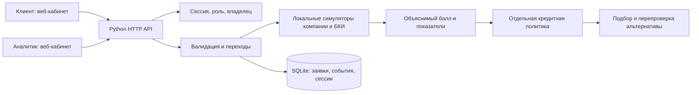
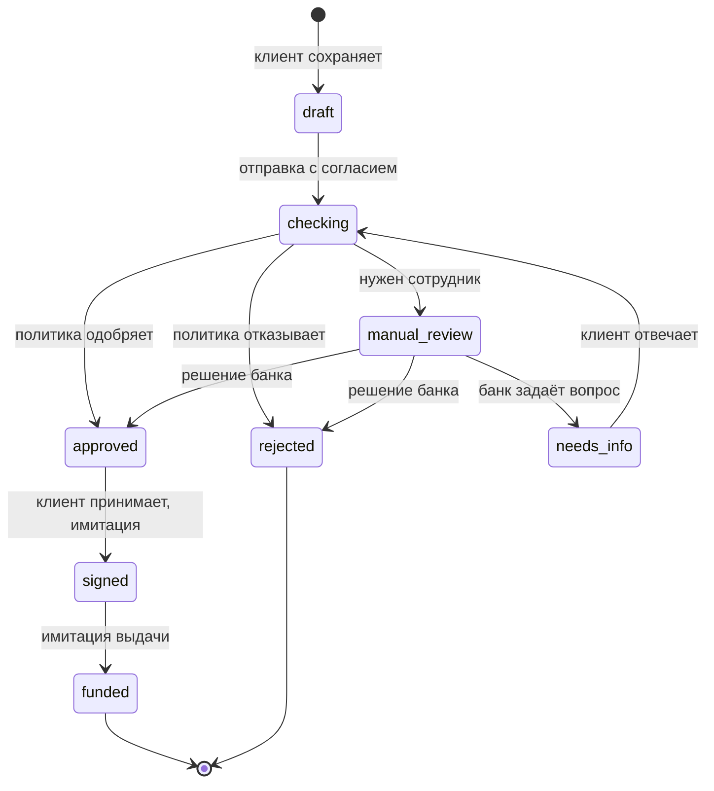
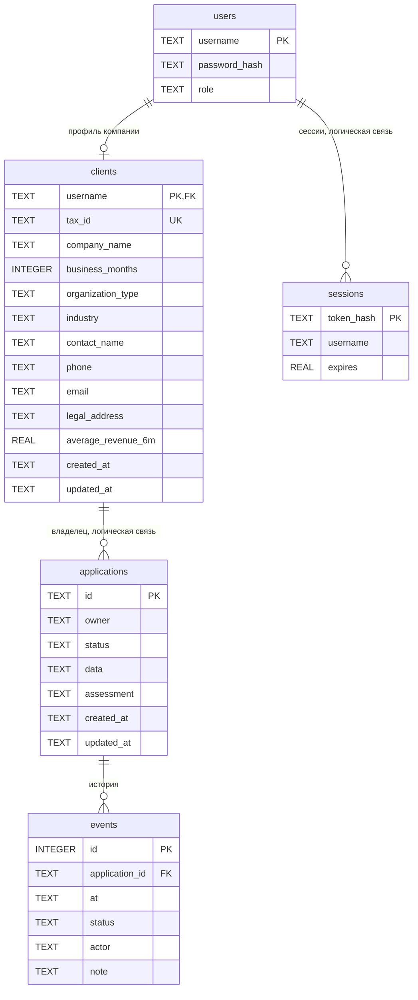

# Архитектура решения

## Компоненты

Компоненты работают в одном процессе Python внутри Docker-контейнера. Слой кредитных правил отделён от HTTP и БД. Проверки компании и БКИ воспроизводятся локальными симуляторами, поэтому основной сценарий работает автономно.

## Состояния

`checking` и `signed` — синхронные этапы, записываемые в историю. Интерфейс получает итог обработки запроса вместе с событиями переходов.

После уточнения неблокирующий результат снова передаётся человеку. Пояснение клиента само по себе не отменяет просрочку или другой отрицательный факт. Автоматически отклонённую заявку нельзя одобрить через банковский endpoint.

## Данные

| Таблица | Поля | Смысл |
|---|---|---|
| `users` | `username` PK, `password_hash`, `role` | Учётные записи и роль client/bank |
| `clients` | `username` PK/FK → users, `tax_id` UNIQUE, реквизиты, возраст, контакты, средняя выручка, даты | Профиль компании |
| `applications` | `id` PK, `owner`, `status`, `data` JSON, `assessment` JSON, `created_at`, `updated_at` | Последняя версия заявки и расчёта |
| `events` | `id` PK, `application_id` FK, `at`, `status`, `actor`, `note` | Хронология действий |
| `sessions` | `token_hash` PK, `username`, `expires` | SHA-256 токена случайной сессии, срок 8 часов |

Пользователи и профили компаний хранятся в таблицах `users` и `clients`. Начальные данные берутся из `data/clients.json`; пароль сохраняется как PBKDF2-хеш. Анкета и результат расчёта хранятся в JSON; поля описаны в OpenAPI.

`assessment` содержит `checks`, `score`, `decision`, `alternative`, `product_alternatives` и `missing_documents`; после ручного действия добавляется `bank_decision`. Автоматическая оценка и решение сотрудника хранятся отдельно. Интерфейс показывает фактический статус заявки и соответствующее предложение.

## Расчёт

- Свободный поток = выручка − операционные расходы − текущие кредитные платежи.
- Новый платёж — аннуитет по условной ставке выбранного продукта.
- Покрытие = свободный поток / новый платёж. Значение ниже 1 означает недостаток потока; порог автоматического одобрения зависит от продукта: от 1,2 до 2,0; для разового оборотного кредита — 1,5.
- Балл учитывает покрытие, возраст бизнеса и синтетические проверки. Результат правил отдельно ограничивает выдачу при неактивной компании, серьёзной просрочке и других препятствиях.
- Альтернатива перебирает допустимые сроки, вычисляет сумму под порог выбранного продукта и дополнительный запас 0,5 платежа и заново вызывает скоринг и политику. Приоритет: улучшенный статус, максимальная сумма, затем минимальный срок. Подбор основан на эвристике и не гарантирует минимальную стоимость кредита.
- Стресс-тест вызывает `/api/preview` для исходной анкеты и копии со сниженной выручкой. Ни один расчёт не сохраняет заявку.

## Надёжность и доступ

Каждая мутация состояния и её события выполняются в одной SQLite-транзакции `BEGIN IMMEDIATE`. Параллельная повторная отправка/выдача получает 409 после проверки уже изменившегося состояния. Это защита перехода, а не универсальная идемпотентность создания заявки: два отдельных POST создания дадут два черновика.

Клиент читает и меняет только свои заявки. Банк читает все заявки, но принимает решение только на `manual_review`. Редактировать анкету банк не может. Строковые значения передаются в SQL параметрами; браузер экранирует пользовательский текст.

Сессия хранится в HttpOnly SameSite=Strict cookie. На сервере проверяются Host и Origin для записи; CORS не включён. JSON ограничен 64 КиБ. CSP запрещает внешние скрипты и inline-код. Для локального HTTP COOKIE_SECURE=0; при HTTPS COOKIE_SECURE=1 добавляет Secure при входе и выходе. Render hostname добавляется к разрешённым Host из окружения платформы.

## Границы реализации

Приложение рассчитано на один экземпляр сервера с SQLite в постоянном томе. Учётные записи демонстрационные; проверки компании, БКИ, подписание и выдача смоделированы. Для промышленного размещения предусмотрено дальнейшее развитие идентификации, резервного копирования, мониторинга и серверной БД. Направления развития перечислены в README.

## Как проверять

Сценарии и ожидаемые результаты описаны в [руководстве по проверке](VERIFICATION.md). Автоматические тесты находятся в `tests/`, подробный пользовательский путь — в README.

## Связи данных

Колонки data и assessment содержат JSON с анкетой и результатами расчёта.
Явные внешние ключи БД: clients.username → users.username и
events.application_id → applications.id. Связи applications.owner и
sessions.username обеспечиваются логикой приложения.
Карточка заявки получает актуальный профиль компании при чтении. История событий
фиксирует изменения состояния; реквизиты компании берутся из текущего профиля.
Исходные CSV остаются на устройстве пользователя; в JSON анкеты сохраняются
имена файлов, источники и рассчитанные числовые показатели.

## Контракты и воспроизводимая проверка

Все 15 маршрутов HTTP API описаны в [OpenAPI](openapi.json).
Сводка доступа, ошибок и действий — в [описании API](API.md).
[Коллекция запросов](requests.http) проходит создание, отправку, получение
предложения, цикл уточнения и ручное решение с действующими аккаунтами.
Тест tests/test_delivery.py выполняет запросы этой коллекции через настоящий
диспетчер Handler и временную SQLite; сетевой HTTP отдельно покрыт tests/test_api.py.

Docker запускает один экземпляр сервера, хранит состояние вне контейнера и
принимает конфигурацию из окружения. HEALTHCHECK проверяет доступность HTTP и SQLite.
Внешние банковские системы и облачные зависимости не нужны.
